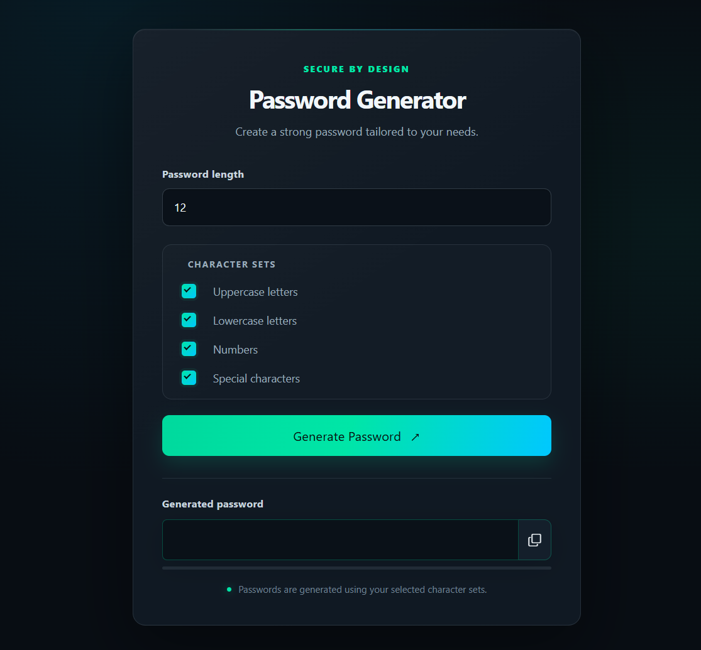

[](https://hits.dwyl.com/mihaiapostol14/Bootstrap-Generator-Password-Form-v1)


# Bootstrap Generator Password Form

A browser-based password-generator form interface built with HTML, Bootstrap, CSS, and JavaScript. The page provides a numeric symbol-count field, a read-only password display, and controls for generating, exporting, and copying a password. In the current implementation, password generation and export are not wired up, and the copy handler's selector does not match the password input markup.


## Preview



## Tech Stack

- HTML5
- CSS3
- JavaScript (browser APIs)
- Bootstrap 5.3.3 for layout and form styling
- Font Awesome 6.7.2 for the copy icon

Bootstrap and Font Awesome are loaded from CDNs; an internet connection is required to load those assets.

## Features

- **Responsive form layout:** Bootstrap utility classes center the form and adapt the button layout to screen width.
- **Symbol-count input:** A numeric field accepts the requested symbol count.
- **Password display:** A read-only text field is provided to show a password.
- **Generate and Export controls:** Both buttons are present in the interface; no event handlers or generation/export behavior are implemented in `js/script.js` yet.
- **Copy control:** The copy icon's JavaScript handler attempts to select the password and write it to the clipboard, with a success alert and console error handling. However, the script queries `.show-password`, while the HTML input has the `ShowPassword` ID and no matching class. As written, clicking the icon will not find the input, so copying is not currently functional.
- **Compact custom styling:** `css/style.css` sets a 400px maximum form width, applies a global box-sizing reset, and styles the copy icon.

## Installation and Use

Clone the repository, then open `html/index.html` in a browser. No package installation or build step is required.

```bash
git clone https://github.com/mihaiapostol14/Bootstrap-Password-Form.git
cd Bootstrap-Password-Form
```

## Project Structure

| File Path | Description |
| :--- | :--- |
| [html/index.html](https://github.com/mihaiapostol14/Bootstrap-Generator-Password-Form-v1/blob/new-code/html/index.html) | Form markup and external Bootstrap/Font Awesome assets |
| [css/style.css](https://github.com/mihaiapostol14/Bootstrap-Generator-Password-Form-v1/blob/new-code/css/style.css) | Custom layout and copy-icon styling |
| [js/script.js](https://github.com/mihaiapostol14/Bootstrap-Generator-Password-Form-v1/blob/new-code/js/script.js) | Clipboard interaction handler |

## 📝 Author

[Mihai Apostol](https://github.com/mihaiapostol14)
